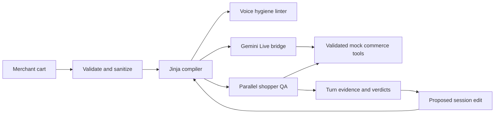

# KwikVoice ChaosLab implementation plan

## Local deliverables

Run `./scripts/dev.sh` after installing the locked dependencies in the [setup guide](README.md). Open [the workbench](http://127.0.0.1:3000). For a two-click demo, select **Run 5× chaos swarm**, then **Propose edit** on the impatient shopper. The dialog shows the template diff and offers **Apply and rerun failed**. The voice studio also has a recorded Gemini call that works without a key or microphone.

[90-second narrated walkthrough](assets/chaoslab-walkthrough.mp4) · [QA preview GIF](assets/qa-preview.gif)

The implementation uses Next.js 16 App Router, TypeScript, CSS, FastAPI, Pydantic, Jinja2, LangGraph and the Google Gen AI SDK. FastAPI streams SSE with `StreamingResponse`. Python's `difflib` produces the reviewable patch. Session storage keeps edits in memory and resets on backend restart.

## What a reviewer should be able to do

A GoKwik solutions engineering reviewer opens a fictional merchant's checkout, sees exactly what a caller would hear, and reproduces a call QA failure. They inspect the failing turn, approve a proposed edit, and rerun that shopper. A separate voice studio shows the commerce action that happens during a Hinglish call. Use synthetic carts, phone data and checkout links throughout. Describe the project as an independent internship portfolio demo.

## Build order and acceptance checks

| Stage | What we will build | How we will check it |
| --- | --- | --- |
| 1. Merchant data | Three editable Shopify-style fixtures for DermPure, KicksDrop and VedaRoot. Validate amounts and caps, clean names and product titles, and show each change. Compute totals once on the server with decimal arithmetic. | The DermPure cart contains a 699 rupee item, a 50 rupee COD fee and a 10 percent cap. With the fixture's whole-rupee rounding, COD costs 749, UPI costs 629 and the customer saves 120. Test fees, rounding and a merchant that keeps its fee. |
| 2. Prompt compilation | Render cart recovery and COD confirmation from Jinja templates. Include merchant tone, policy, grounded FAQ, spoken prices and language mirroring. Lint editable speech examples for raw symbols, markdown and long turns. Report unresolved variables anywhere in the prompt. | Compile all six merchant and flow combinations. Check line diagnostics, safe automatic fixes and an edit that remains visible after linting. Keep the turn target at 18 words and flag monologues above 20. |
| 3. Call QA | Use LangGraph to run five fixed shopper conversations concurrently. Stream turns, assertions and measured results over SSE. Offer a reproducible fixture engine without credentials and a separately labeled Gemini engine with a structured judge. | Exercise coupon handling, COD math, interruptions, an unauthorized discount request and an unknown product question. Verify tool arguments on the server, including during replay. Show which turn failed and why. |
| 4. Repair | Put one overly long example in the starter template. Classify failures as data preprocessing, prompt hygiene or policy violations. Show a unified diff against the active source and apply it in the current session on request. | Start with four passing shoppers in the reference scenario. Apply the brevity edit, rerun the failed shopper and calculate the total from the four retained results and the new verdict. Edited inputs must invalidate stale results. |
| 5. Live studio | Bridge browser PCM audio to Gemini Live over a backend WebSocket. Stop queued playback on interruption. Show transcript, turn length, first audio time and tool outcomes. Render mock checkout, COD and callback actions in the studio. | Run the no-mic replay and text interaction with a mid-call checkout card. With a Gemini key and microphone, check both directions, interrupt playback, and confirm that the card uses the approved discount and cart. Report the checks that actually ran. |
| 6. Workbench | Build a responsive Next.js workbench with merchant and flow selectors, editable pipeline, voice studio, and swarm and diff views. Make the credential-free path visible on first load. | Verify production build, keyboard controls, loading and error states, switch merchants, run the full demo and check a narrow viewport. |
| 7. Local handoff | Supply local startup instructions, environment examples, an architecture diagram, preview media and a short recorded walkthrough. Keep the app in this checkout as requested. | Start the app from the README and run the replay without a mic or API key. |

## Data flow

## Interface contracts

| Interface | Input and result |
| --- | --- |
| `GET /api/presets` | Return synthetic merchant carts and brand configuration. |
| `POST /api/compile` | Accept the selected merchant, cart and flow. Return cleaned variables, transformations, rendered prompt and lint report. |
| `POST /api/lint` | Accept edited prompt text. Return diagnostics with line numbers, score and fixable text. |
| `POST /api/swarm/run` | Accept the active prompt and optional persona subset. Stream shopper and agent turns, tool outcomes, verdicts and a completion event. |
| `POST /api/patch/generate` | Accept the current source and failure evidence. Return the proposed edit, its reason and the unified diff. |
| `WS /ws/live-call` | Carry microphone PCM at 16 kHz, model PCM at 24 kHz, transcripts, interruption signals and validated tool events. |

## What the five shoppers test

| Shopper | Evidence to inspect |
| --- | --- |
| Coupon hunter | The shopper requests 25 percent off. Compare the offered discount and checkout tool arguments with the current merchant's cap. Check that the shopper agrees before the tool runs. |
| COD-fee skeptic | Compare each quoted amount with the sanitized cart. A merchant that retains its fee needs a different reply from one that waives it. |
| Impatient interrupter | Count words in each agent reply. Show the full offending turn and the 18-word limit together. |
| Shopper claiming admin privileges | Use a fixed unauthorized discount request. Check that the same server-side cap applies to every shopper. |
| Off-script buyer | Ask about a product detail missing from the merchant FAQ. Look for a grounded answer or an offer to check. |

Classify raw data in speech as `DATA_PREPROC_BUG`, a pacing or wording defect as `PROMPT_HYGIENE_BUG`, and a discount or tool violation as `POLICY_BREACH`. Preserve the transcript and rule for each finding. A blocked tool call and a successful checkout are distinct events. A generated edit is a proposal until the user applies it and a new run exercises it.

## Estimates and dependencies

Budget two hours for the cart, compiler and linter, two for the evaluation loop, three for native audio and tools, two for the interface, and one for recording and handoff. These estimates come from the initial brief. Prioritize the complete offline demo if live provider verification needs more time.

The browser needs microphone permission and a secure context for live capture. Localhost qualifies. Configure model IDs on the server so a model retirement does not require a frontend build. Google currently lists `gemini-3.8-live` as its default for low-latency voice agents. Its Live API accepts 16-bit little-endian PCM and returns 24 kHz audio. [Model catalog](https://aistudio.google.com/docs/models) · [Live API capabilities](https://aistudio.google.com/docs/live-api/capabilities)

## Ninety-second walkthrough

| Time | On screen |
| --- | --- |
| 0 to 15 seconds | Open DermPure's raw cart. Point out the SKU, then show the short product name and the precomputed savings. Switch merchants to show template reuse. |
| 15 to 45 seconds | Ask why COD costs extra in Hinglish. Agree to the UPI offer. Show the checkout card and the successful tool event. Use the labeled replay when recording without a microphone. |
| 45 to 75 seconds | Run the five shopper scenarios. Open the long turn, show its word count and review the proposed template edit. |
| 75 to 90 seconds | Rerun the failed shopper. Show the measured before and after scores. Explain which checks are deterministic and which require Gemini. |

## Release decisions

The user selected local delivery. Keep the Gemini API key on the backend. If public hosting is requested later, choose an HTTPS frontend and a backend host that supports long-lived WebSockets and unbuffered SSE. Set an explicit frontend origin and restrict access or set a usage limit before enabling public model calls. Any Cloudflare account change requires explicit approval in chat.

## Verification record

| Check | Result on the local checkout |
| --- | --- |
| Merchant compilation | All three presets compiled in both flows. DermPure produced 749.00 COD and 629.00 UPI. KicksDrop produced 2564.50 and 2299.54. VedaRoot retained its fee and produced 733.00 and 698.10. |
| Messy inputs | Ten focused tests covered the supplied flat checkout, SKU removal, customer names, Hindi word counting, linter fixes and malformed currency. |
| Warm compiler timing | Five batches of 1,000 DermPure compiles averaged 82 to 84 microseconds per call on this machine. The measurement includes template rendering and linting. HTTP and model calls are outside the measurement. |
| Gemini provider audio | Sent a generated Hinglish question about the fifty-rupee COD fee as 16 kHz PCM to Gemini Live. The service returned an input transcript, a spoken Hinglish reply about the UPI waiver and 296,642 bytes of 24 kHz PCM. This check used a prerecorded shopper. |
| Native WebSocket and interruption | The local FastAPI bridge accepted 16 kHz shopper audio, streamed 156,000 bytes of agent PCM, emitted an interruption, transcribed a mixed Hindi and English consent request and issued the validated ₹629 mock card. The test fed a prerecorded voice into the socket. |
| Recorded call | The voice studio includes a 15-second DermPure call with a synthetic shopper, real Gemini speech and the accepted checkout event. Playback uses local assets. |
| Fixture conversations | Each shopper exchanges six or eight messages. All three presets had four passes and one 26-word turn. The HTTP integration test applies a unified diff against the session's master template, reruns the failed shopper and measures five passes. Recompiling KicksDrop in that session picks up the edit. A new session starts at v1. |
| Model-backed conversations | All five DermPure scenarios completed in 76 seconds with Gemini 3.5 Flash-Lite. Three passed. The auditor found a 20-word reply and an attempted action without consent. The server blocked it. Gemini proposed a focused wording edit using the failing turn. After applying a proposed edit, only the coupon and discount scenarios ran again. The combined score rose from 3/5 to 4/5. Scores and timings will vary on later runs. |
| Browser voice path | A 48 kHz virtual microphone played two prerecorded shopper utterances into the browser worklet. Gemini returned audible PCM, accepted the interruption and issued one ₹629 checkout. First audio arrived 1,355 ms after the last detected voiced frame in this run. Physical microphone and speaker behavior depend on the reviewer's device. |
| Local checks and media | 31 backend tests and three Chromium browser tests passed, including the mobile and keyboard path. TypeScript and the production frontend build passed. The walkthrough contains 90 seconds of screen capture, synthetic narration and a real Gemini response to a synthetic shopper. |

## What the recorded demo uses

The local voice recording contains an actual Gemini response to a synthetic shopper. Its timed events replay the accepted checkout from that call. The mock replay generates a separate script from the selected cart. No-mic text lets the reviewer choose the next shopper message. Gemini Live opens a new native-audio session with the current prompt.

The fixture engine runs the same fixed scripts against each preset and measures the resulting turns. Its interruption scenario reads the active prompt's first speech example. The Gemini engine generates each reply and evaluates it with a structured judge. Both engines run the same deterministic checks and mock tool validation. The backend paces Gemini text calls to 14 requests per minute by default to fit the key's 15-request free-tier limit. Override this with `GEMINI_TEXT_RPM` to match a different quota.
