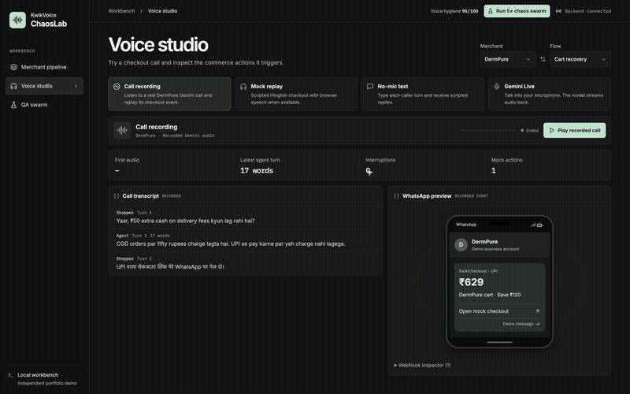

# KwikVoice Studio

KwikVoice Studio is an independent portfolio project for testing voice agents on synthetic checkout calls. The workbench compiles merchant data into a voice prompt, shows the evidence behind five QA verdicts, and lets you review and test a prompt edit. All commerce actions are local simulations.

[Public recorded demo](https://koushikktech.github.io/KwikVoice-Studio/) · [Earlier workbench walkthrough](assets/chaoslab-walkthrough.mp4) · [Implementation notes](IMPLEMENTATION.md)

The public demo plays a recorded Gemini call and shows its mock checkout and a captured fixture QA run. Run the workbench locally to edit inputs, rerun tests, or place Live calls with your own Gemini key.

## Start locally

Install Node.js 22 or later, npm, and [uv](https://docs.astral.sh/uv/). The commands below install Python 3.11 and the locked dependencies.

~~~sh
uv sync --project backend --python 3.11
npm ci --prefix frontend
./scripts/dev.sh
~~~

Open [the workbench](http://127.0.0.1:3000). The FastAPI server runs at [127.0.0.1:8000](http://127.0.0.1:8000/docs). Press Ctrl+C to stop both servers.

The default setup works without environment files. To change the settings, copy [backend/.env.example](backend/.env.example) to `backend/.env` and [frontend/.env.example](frontend/.env.example) to `frontend/.env.local`. Restart the servers after changing either file.

| Setting | Default | Purpose |
| --- | --- | --- |
| `GEMINI_API_KEY` | Empty | Enables Gemini Live and Gemini text QA. Store the key in the backend environment. |
| `GEMINI_TEXT_MODEL` | `gemini-3.5-flash-lite` | Text model that plays the merchant agent in QA. |
| `GEMINI_TEXT_RPM` | `14` | Maximum text requests per minute per model in this backend process. |
| `GEMINI_JUDGE_MODEL` | Same as the text model | Model that grades scenario behavior and proposes edits when a deterministic edit does not match. |
| `GEMINI_LIVE_MODEL` | `gemini-3.8-live` | Model that streams audio in the voice studio. |
| `WORKBENCH_ORIGINS` | `http://localhost:3000,http://127.0.0.1:3000` | Comma-separated browser origins the backend accepts for HTTP and WebSocket requests. |
| `NEXT_PUBLIC_API_URL` | `http://127.0.0.1:8000` | Backend address used by the browser. |

If you prefer separate terminals, run these commands from the project root.

~~~sh
uv run --directory backend uvicorn chaoslab.main:app --host 127.0.0.1 --port 8000
npm run dev --prefix frontend -- --hostname 127.0.0.1 --port 3000
~~~

## Walk through the local demo

Start a live call and speak in English, Hindi, Tamil, Telugu, Kannada or Malayalam. Ask for a price, interrupt with another question, or switch languages. A direct request to send a checkout link counts as consent. The server checks the request and the amount before it creates a mock checkout.

Without a Gemini key, the page opens on a recorded DermPure call. The call mode menu also offers a scripted Hinglish call and an English text demo. The order preview appears when an action occurs.

Expand **Merchant and prompt** to change the merchant, flow, cart or prompt. Expand **Test conversations** and select **Run all five** to inspect the QA results. The fixture includes a deliberately long sample reply to demonstrate patch review. The Live and Gemini QA models receive the conversation instructions without that fixture sample.

## How it works

~~~mermaid
flowchart LR
    Workbench[Next.js workbench] --> Compile[Validate cart and render Jinja]
    Compile --> Prompt[Active prompt and price context]
    Prompt --> QA[Concurrent LangGraph scenarios]
    Prompt --> Studio[WebSocket call modes]
    QA --> Tools[Validated mock commerce tools]
    Studio --> Tools
    Studio <--> Live[Gemini Live]
    QA --> SSE[Turns, assertions and verdicts over SSE]
    SSE --> Workbench
    Workbench --> Patch[Review and apply a session edit]
    Patch --> Compile
~~~

| Interface | Behavior |
| --- | --- |
| `GET /api/presets` | Returns the synthetic merchant data, fixed personas and Gemini availability. |
| `POST /api/compile` | Accepts a cart, brand and flow. Returns the session ID, revision, cleaned variables, transformations, prompt and lint report. Include the existing session ID to reuse its base template. |
| `POST /api/lint` | Returns line diagnostics, a score and the prompt with safe fixes applied. |
| `POST /api/swarm/run` | Streams the selected fixed personas for the active session revision. Accepts a persona subset or a failed-only rerun after applying a patch. |
| `POST /api/patch/generate` and `POST /api/patch/apply` | Propose a diff from measured failures, then apply the reviewed diff to the current session. |
| `WS /ws/live-call` | Streams call events for replay, text or Live. Live takes signed little-endian 16-bit PCM at 16 kHz and returns PCM at 24 kHz. |

The server computes prices with decimal arithmetic. All three mock actions check the current cart and explicit caller consent. UPI and COD actions also check the exact server amount, and UPI checks the approved discount. The AudioWorklet sends microphone PCM in 20 ms blocks. When Gemini reports an interruption, the browser stops playing audio and clears its queue.

QA compares actual reply lengths and quotes with configured limits and amounts. It classifies failed checks as data preprocessing, prompt hygiene or policy violations. The deterministic fixture reproduces the starter brevity failure without a model. The Gemini engine grades replies against scenario criteria and reports whether the tool requests passed server validation.

Sessions live in backend memory. A restart clears their prompts, patches and QA results. Changes to the merchant, cart, flow or prompt invalidate measured results. After applying a patch, the score keeps the prior results until the failed-only run replaces their verdicts. The approved starter edit changes the session's shared Jinja template, so it carries over to other merchant and flow combinations. Edits to rendered text apply to the active prompt.

## Checks

~~~sh
uv run --directory backend pytest -q
npm run typecheck --prefix frontend
npm run build --prefix frontend
npm exec --prefix frontend -- playwright install chromium
npm test --prefix frontend
~~~

Playwright starts separate localhost servers on ports 3001 and 8001 with an empty Gemini key. To use an installed Chrome build, run `KWIKVOICE_BROWSER_CHANNEL=chrome npm test --prefix frontend`. The backend tests cover compilation, concurrent QA, session edits, replay, tool validation and the WebSocket bridge with a Gemini test double. The browser suite exercises the credential-free workflow. To verify a real Live call, use the microphone steps above.

This project runs on localhost. It uses synthetic names, phone numbers and checkout URLs throughout.
